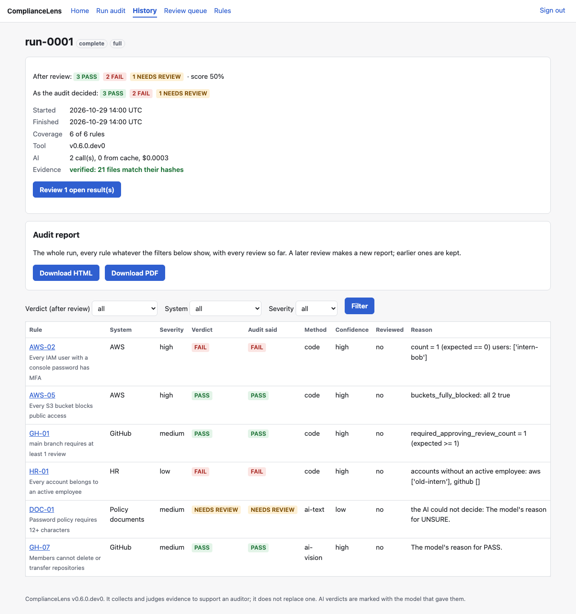

# ComplianceLens

ComplianceLens checks a company's security rules (for example "every user has MFA" or
"code needs a review before merging") across AWS, GitHub, an HR employee list and policy
documents. It saves tamper-evident proof for each rule and decides **PASS**, **FAIL** or
**NEEDS REVIEW** with a reason. An AI model judges what code can't read (screenshots and
policy documents), and a person reviews anything unclear in a web dashboard. Nothing ever
defaults to PASS.

It is a 15-week semester project. The tool lives in [`compliance-lens/`](compliance-lens/);
start with its [README](compliance-lens/README.md).

## Status

**Current version: V5, tagged `v5.0` (version 0.5.0); V6 is being finished** (its code is
in `main`; the live checks and the release are left).

| Version | What it added | Status |
| --- | --- | --- |
| V1 Foundations | Rules as YAML cards, AWS and GitHub connectors, code checks | ✅ `v1.0` |
| V2 Rules and evidence store | 14 rules, an HR list, evidence with SHA-256 hashes, SQLite history, `verify` | ✅ `v2.0` |
| V3 Screenshots | Playwright screenshots with a banner, saved logins, login problems reported | ✅ `v3.0` |
| V4 AI evaluation | Any AI model judges screenshots and policy documents; 19 rules | ✅ `v4.0` |
| V5 Dashboard and review | Web dashboard, human reviews, run comparison, rules on/off; the research experiment's main run | ✅ `v5.0` |
| V6 Reports and polish | HTML/PDF audit report and export, a settings file, logging, the experiment's write-up | 🟡 code done; live checks and release left |
| V7 Final presentation | Demo, slides, stretch goals | ⬜ week 15 |

The plan is in [`ComplianceLens Project Plan.md`](ComplianceLens%20Project%20Plan.md),
and what's done (with every decision and a dated log) is in
[`Project Progress.md`](Project%20Progress.md).

## What it does

- **19 rules** written as small YAML files, not code: AWS (password policy, MFA, old
  access keys, inactive users, S3, CloudTrail), GitHub (branch protection, security
  features, members' 2FA, organization settings), HR (every account belongs to an active
  employee) and policy documents (passwords, MFA, offboarding).
- **Evidence for every run:** the raw API data, a screenshot with a banner (rule, UTC time,
  URL) and a manifest of SHA-256 hashes, plus a SQLite history. `verify` reports any file
  changed after the audit.
- **AI where code can't reach:** an AI model of your choice (set in `.env`: OpenAI,
  Anthropic, or a local model) reads one screenshot-only setting (GH-07) and three policy
  documents. Only a clear, consistent answer becomes PASS or FAIL; anything else is
  NEEDS REVIEW with the reason. GH-06 (the base repository permission) moved from the AI
  to code in V6: its value is in the API, and in the research experiment below the code
  reading the API matched the setup in 55 of 55 cases.
- **Web dashboard (V5):** start an audit and watch its progress, read each result with
  its evidence, review uncertain results (reviews are added, never edited), compare two
  runs, and turn rules on or off. It runs on your computer only, behind a password.
- **Audit report (V6):** one HTML page and a PDF of it, built from the saved run only: a
  cover with what was audited and the score, the failures first with their evidence and
  suggested fixes, every human review, and every evidence file's SHA-256. See the
  [sample report](compliance-lens/docs/sample-report.pdf) (a made-up audit).



## Quick start

```bash
cd compliance-lens
make setup               # Python 3.11+, installs everything + Chromium
cp .env.example .env     # fill it in: see "Account setup" in compliance-lens/README.md
make test                # the tests, no accounts needed
make audit               # a real audit (without accounts every rule says why it can't decide)
make report RUN=run-0001 # its report, HTML and PDF (the PDF needs: brew install pango)
make dashboard           # the web dashboard on http://127.0.0.1:8000
```

## Research experiment

How accurately does an AI read a compliance setting from a **screenshot**, compared with
code reading the same setting from the **API**? 55 pictures of real AWS and GitHub
settings (including dark theme, small text, cut-off and covered pages, and prompt
injection) were labelled by two people separately (Cohen's κ = 0.97). `openai/gpt-6-luna`
then judged each picture 3 times.

| | AI vs the labels | AI vs the set-up state |
| --- | --- | --- |
| Decided accuracy | 95% | 99% |
| False PASS (the dangerous error) | 7% (6 of 90) | 0% (0 of 84) |
| Unclear pictures sent to review | 12 of 12 | – |

All 6 false PASSes are two AWS-02 pictures that both people labelled FAIL, although the
rule's written condition, the setup and the code all say PASS. The code reading the API
matched the setup in 55 of 55 cases. The whole run cost $0.05. The write-up, with
figures and examples: [`docs/experiment-writeup.md`](compliance-lens/docs/experiment-writeup.md).

## Repository layout

| Path | What it is |
| --- | --- |
| [`compliance-lens/`](compliance-lens/) | The tool: code, rules, tests, experiment, docs |
| [`ComplianceLens Project Plan.md`](ComplianceLens%20Project%20Plan.md) | The semester plan, version by version |
| [`Project Progress.md`](Project%20Progress.md) | What's done, decisions, how to test each version, log |
| `meetings/` | Meeting notes template |
| `.github/workflows/` | CI: lint and tests on every change to `compliance-lens/` |
| `.pre-commit-config.yaml` | Before each commit: secret scan and code style |

The repository keeps the name of the team's first proposal, **SentinellAI**; the
project built in it is ComplianceLens.

## Team

- Dev Patel
- Harishita Gupta
- Indraneel Sarode
- Vatsal Gandhi

## Disclaimer

ComplianceLens is a research and automation aid. It does not replace legal advice or a
certified compliance audit. Only point it at accounts you own: the tool itself only
reads, but the research experiment changes test settings (and puts them back).
