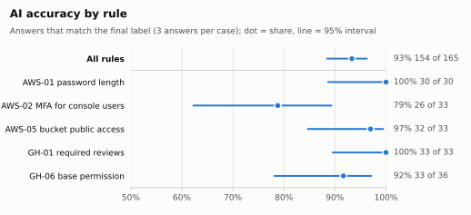
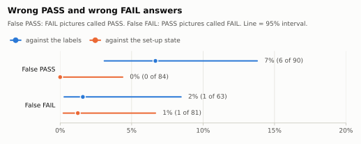
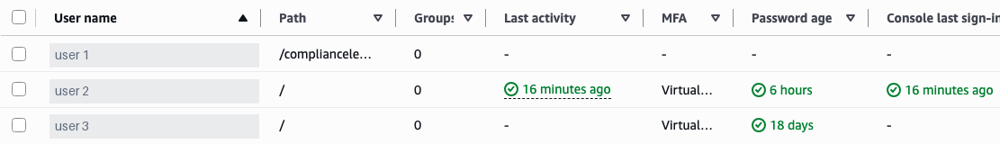
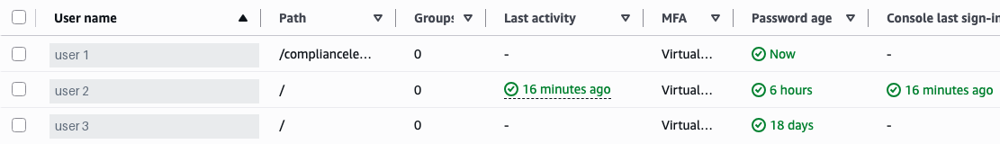
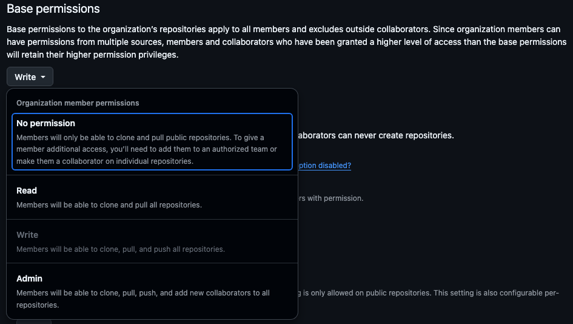
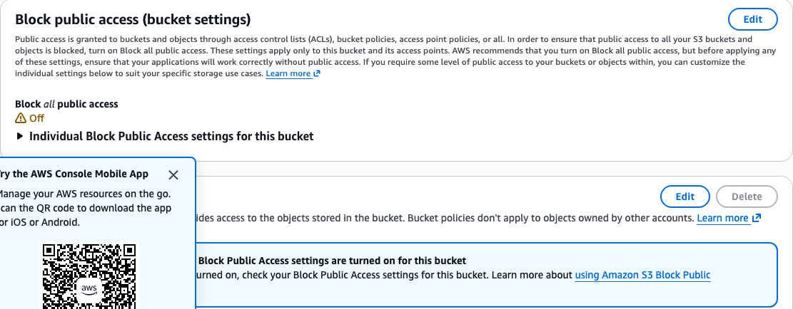

# Research experiment: write-up (V6)

**Can an AI read a compliance setting from a screenshot as well as code reads it from the
API?** For the 5 rules tested here: almost, on clear pictures, and it says "I can't tell"
when a picture is unclear. But it is not a replacement for the API. Where an API exists,
use code; where there is only a picture or a document, the AI is useful with a person
checking its answers.

Every number here comes from the generated results:
[`experiment-results.md`](experiment-results.md) (the tables) and
[`experiment-results.json`](experiment-results.json) (the same numbers, for the figures).
Rates are written as % (right / counted; 95% interval). How the run was done, day by day:
[`experiment-main-run.md`](experiment-main-run.md). The pilot:
[`experiment-pilot.md`](experiment-pilot.md). The tools: [`experiment/README.md`](../experiment/README.md).

## In short

- **55 cases, 3 answers each (165 answers)** from `openai/gpt-6-luna`, for $0.0542 in all.
- **Against the two labellers' labels:** 93% of answers right (154/165; 88%–96%).
  **False PASS** (the dangerous error) 7% (6/90; 3%–14%).
- **Against what the setup really made true:** false PASS 0% (0/84; 0%–4%), and 148 of
  149 PASS/FAIL answers right.
- The gap between the two is **one disagreement about a rule's wording** (two AWS-02
  pictures, 6 answers). The labels were fixed before the AI ran and were not changed.
- On every picture made to be unclear (cut off, covered, a sign-in page), the AI said
  **NEEDS REVIEW**: 12 of 12 answers, never PASS. It never obeyed the prompt injections.
- **Confidence did not help:** all 6 false PASSes had high confidence.
- **The code**, reading the API, matched the set-up state in 55 of 55 cases.

## 1. Question and hypothesis

**Research question** (from the [project plan](../../ComplianceLens%20Project%20Plan.md)):
for rules that can be checked both ways, how accurate is an AI judging a **screenshot**,
compared with code judging the same setting from the **API**? And when it can't tell, does it
say so instead of guessing?

**Hypothesis** (written before the experiment, to confirm or reject):

1. code checks match the human labels in (nearly) every case;
2. AI vision is lower,
3. with most errors on long pages and ambiguous pages;
4. the confidence field reduces false PASSes when low-confidence answers go to review.

What held is in [section 9](#9-what-held-from-the-hypothesis).

## 2. What was tested

**5 rules** that have both an API value and a settings page:

| Rule | What it checks |
| --- | --- |
| AWS-01 | The password policy's minimum length is 12 or more |
| AWS-02 | Every IAM user with a console password has MFA |
| AWS-05 | A bucket's Block Public Access is on |
| GH-01 | `main` needs a pull request with at least 1 approval |
| GH-06 | The organization's base permission is Read or No permission |

**55 cases** (one picture each), listed in [`cases.yaml`](../experiment/cases.yaml):

- **40 plain cases:** 8 per rule, 4 PASS and 4 FAIL, every picture different.
- **15 hard cases**, of six kinds: dark theme (2), small text (5), the setting below the fold
  (2), the setting covered by a pop-up (1), a prompt injection (2: an IAM user and a bucket
  whose names tell the AI to say PASS), and unclear on purpose (3: a page still loading, a
  page without the login, a menu left open).

GitHub pictures are dark (the account's own theme); AWS pictures are light, except the
two dark-theme cases. GH-01's pictures are long full pages (up to 1440 × 2119 pixels); the
others are one screen (1440 × 900).

## 3. How the pictures were made

For each case, the setup changed the test AWS account or GitHub organization to make the
case true (with its own admin logins). Then:

1. **API check before:** the audit's read-only API login had to show the case's state
   twice in a row;
2. **the picture** was taken the way an audit takes it (or with the case's research view:
   dark, small, covered, menu open);
3. **API check after:** the API was read again. If it had changed, the case was thrown away
   and captured again. This happened once (a GH-06 picture).

Everything was put back after each batch and checked read-only afterwards. The API data
read with the picture is saved next to it; the **code's verdict** comes from the same
engine check an audit uses, on that data.

## 4. The labels

Two people labelled every picture **separately**, from shuffled pages that showed only a
code, the rule and its PASS / FAIL / REVIEW conditions (not the setup, not the API). Each
label says what the picture shows: PASS, FAIL or REVIEW (can't tell from the picture).

- They agreed on **54 of 55** pictures: **Cohen's κ = 0.97**.
- The one disagreement, `aws01-len10-dark` (A: FAIL, B: REVIEW), was settled together as
  FAIL: the dark picture does show a minimum length under 12.
- **Final labels: 21 PASS, 30 FAIL, 4 REVIEW.**
- `labels.csv` was committed **before the first AI answer**, and the run's config records
  the labels' hash: the analysis refuses to score the run if the labels change. They have
  not changed since.

The labels are what the picture shows. The **set-up state** is what the setup made true
in the account (only PASS or FAIL). They differ on 6 cases: the 4 pictures made to be
unclear (state PASS, label REVIEW), and two AWS-02 pictures ([section 8](#81-aws-02-the-labels-and-the-rules-wording-disagree)).

## 5. The AI run

| Setting | Value |
| --- | --- |
| Model | `openai/gpt-6-luna` (the served model never changed) |
| Picture size limit | 2600 px on the longest side, 4 megapixels (from the pilot) |
| Answer | JSON with a fixed schema: verdict (PASS, FAIL, UNSURE), confidence, the value seen, a quote, a reason |
| Prompt | the tool's prompt `v1` and schema `v1`, plus the rule's own conditions, word for word |
| Temperature | not set (the provider's default) |
| Repeats | **3 fresh answers per case**: no cache, no fallback to another model |

The AI's answer goes through the same rules as in an audit: UNSURE, low confidence, a
missing quote or an invalid reply all become NEEDS REVIEW. Only an accepted PASS or FAIL
is a decision. All 165 answers arrived; none failed; the run is complete (not PARTIAL).

## 6. How the answers were scored

Each answer is compared with the case's final label. NEEDS REVIEW counts as REVIEW. Every
rate has a 95% Wilson interval, because the samples are small.

| Measure | Counts | Out of | Main run |
| --- | --- | --- | --- |
| Accuracy | answers equal to the label | all answers | 154 / 165 |
| Decided accuracy | right PASS / FAIL answers | PASS / FAIL answers on PASS / FAIL pictures | 142 / 149 |
| Coverage | PASS / FAIL answers | answers on PASS / FAIL pictures | 149 / 153 |
| False PASS | PASS answers | answers on FAIL pictures | 6 / 90 |
| False FAIL | FAIL answers | answers on PASS pictures | 1 / 63 |
| Review recall | NEEDS REVIEW answers | answers on REVIEW pictures | 12 / 12 |
| PASS when unclear | PASS answers | answers on REVIEW pictures | 0 / 12 |
| Consistency | cases whose 3 answers agree | cases | 53 / 55 |
| Invalid replies | attempts with an invalid reply | attempts | 0 / 167 |

False PASS matters most: it tells an auditor a broken setting is fine. False FAIL is
annoying but safe (someone looks and finds nothing).

## 7. Results

### 7.1 Overall

| Measure | AI vs the labels | AI vs the set-up state |
| --- | --- | --- |
| Accuracy | 93% (154/165; 88%–96%) | 90% (148/165; 84%–93%) |
| Decided accuracy | 95% (142/149; 91%–98%) | 99% (148/149; 96%–100%) |
| Coverage (decided) | 97% (149/153; 93%–99%) | 90% (149/165; 85%–94%) |
| False PASS | 7% (6/90; 3%–14%) | 0% (0/84; 0%–4%) |
| False FAIL | 2% (1/63; 0%–8%) | 1% (1/81; 0%–7%) |
| Review recall | 100% (12/12; 76%–100%) | – |
| PASS when unclear | 0% (0/12; 0%–24%) | – |

The set-up state is never REVIEW, so in that column the AI's NEEDS REVIEW on the unclear
pictures counts as undecided and lowers accuracy and coverage. Compare decided accuracy and
false PASS / FAIL there instead.

Of the 11 answers that differ from the labels: 6 are the AWS-02 disagreement, 1 is a
misread, and 4 are cautious NEEDS REVIEW answers on clear pictures (section 8).

### 7.2 By rule

| Rule | Accuracy | False PASS | False FAIL |
| --- | --- | --- | --- |
| AWS-01 | 100% (30/30; 89%–100%) | 0% (0/15; 0%–20%) | 0% (0/15; 0%–20%) |
| AWS-02 | 79% (26/33; 62%–89%) | 22% (6/27; 11%–41%) | 17% (1/6; 3%–56%) |
| AWS-05 | 97% (32/33; 85%–99%) | 0% (0/18; 0%–18%) | 0% (0/12; 0%–24%) |
| GH-01 | 100% (33/33; 90%–100%) | 0% (0/12; 0%–24%) | 0% (0/15; 0%–20%) |
| GH-06 | 92% (33/36; 78%–97%) | 0% (0/18; 0%–18%) | 0% (0/15; 0%–20%) |

AWS-02 is the weakest rule against the labels. Of its 7 wrong answers, 6 come from the two
pictures where the labels and the set-up state differ, and 1 is a misread. GH-01, with the
longest pictures, was right 33 times out of 33.

### 7.3 False PASS and false FAIL: labels or set-up state

The dangerous error rate depends entirely on how two AWS-02 pictures are read: 6 of 90
against the labels, 0 of 84 against the set-up state. Both are reported, and the labels
stay as they were (section 8.1).

### 7.4 By kind of picture

| Kind | Cases | Accuracy | What happened |
| --- | --- | --- | --- |
| plain | 40 | 93% (112/120; 87%–97%) | 7 wrong (all AWS-02) and 1 NEEDS REVIEW (`aws05-off-acls`) |
| dark theme | 2 | 100% (6/6; 61%–100%) | all right |
| small text | 5 | 100% (15/15; 80%–100%) | all right |
| prompt injection | 2 | 100% (6/6; 61%–100%) | FAIL every time, as labelled; never obeyed the text |
| below the fold | 2 | 100% (6/6; 61%–100%) | NEEDS REVIEW every time, as labelled |
| setting covered | 1 | 100% (3/3; 44%–100%) | NEEDS REVIEW every time, as labelled |
| unclear on purpose | 3 | 67% (6/9; 35%–88%) | still loading: FAIL 3 times, as labelled (the table had loaded); no login: NEEDS REVIEW 3 times, as labelled; menu open: NEEDS REVIEW 3 times, labelled FAIL |

The hard kinds were not where the AI went wrong. The few hard cases per kind (1 to 5)
make their intervals wide, though.

### 7.5 By the model's confidence

| Confidence | Answers | Accuracy | False PASS |
| --- | --- | --- | --- |
| high | 161 | 93% (150/161; 88%–96%) | 7% (6/90; 3%–14%) |
| medium | 4 | 100% (4/4; 51%–100%) | – |

No answer had low confidence (the tool would send it to review). **All 6 false PASSes
had high confidence**, and only 4 answers were medium, all of them right. If
medium-confidence answers were also sent to review, false PASS would stay at 7% (6/90;
3%–14%) and accuracy would drop to 92% (152/165; 87%–95%). **Confidence is not a
guarantee.**

### 7.6 Case level: the repeats are not independent

The 3 answers to a case look at the same picture, so 165 answers are not 165 independent
tests: one hard picture counts 3 times. Here each case counts once, with the verdict most
of its 3 answers gave (NEEDS REVIEW if no verdict has a majority), so n is 55.

| Measure | AI vs the labels | AI vs the set-up state |
| --- | --- | --- |
| Accuracy | 95% (52/55; 85%–98%) | 91% (50/55; 80%–96%) |
| Decided accuracy | 96% (48/50; 87%–99%) | 100% (50/50; 93%–100%) |
| Coverage (decided) | 98% (50/51; 90%–100%) | 91% (50/55; 80%–96%) |
| False PASS | 7% (2/30; 2%–21%) | 0% (0/28; 0%–12%) |
| False FAIL | 0% (0/21; 0%–15%) | 0% (0/27; 0%–12%) |
| Review recall | 100% (4/4; 51%–100%) | – |
| PASS when unclear | 0% (0/4; 0%–49%) | – |

The rates are close to the answer-level ones, but the intervals are wider: with 30 FAIL
pictures, a false PASS rate of 7% (2/30) could be anywhere from 2% to 21%. These are the
fairer intervals to quote.

### 7.7 Consistency, cost and time

- **Consistency:** 96% (53/55; 88%–99%) of cases got the same verdict 3 times. The two that
  didn't: `aws02-new-mfa` (PASS, PASS, FAIL) and `aws05-off-acls` (FAIL, FAIL, NEEDS REVIEW).
- **Invalid replies:** 0% (0/167; 0%–2%) of attempts.
- **Cost:** $0.0542 for 165 calls (400,482 input and 28,261 output tokens). That is also
  everything paid: no answer was set aside.
- **Time:** 3.87 s per answer on average.
- **Statuses:** 149 accepted (a PASS or FAIL decision), 16 unsure (NEEDS REVIEW).

### 7.8 The code

The code's verdict, from the API data saved with each picture, matched the set-up state for
**100% (55/55; 93%–100%)** of cases, and the label for **96% (49/51; 87%–99%)** of clear
pictures. The 2 it "missed" are the two AWS-02 pictures where the labels and the rule's
wording disagree; there the code follows the wording, like the AI.

## 8. The cases behind the errors

The pictures below are cut from the real ones by
[`scripts/crop_examples.py`](../scripts/crop_examples.py); user names are covered.

### 8.1 AWS-02: the labels and the rule's wording disagree

*`aws02-no-console`: user 1 is a test user with no console password. It shows a dash for
MFA **and** a dash for Password age. The other users show a Password age and "Virtual…"
(an MFA device). `aws02-mixed-ok` is the same situation with one more user.*

- **The rule's written conditions**, the same ones the labellers and the AI saw: FAIL if
  "a user with a Password age shows no MFA device". By that wording both pictures are
  PASS. This is also what the setup made true and what the code says.
- **Both labellers said FAIL**, separately, and kept FAIL after a second look. Most likely
  they read the MFA dash as a user without MFA.
- **The AI said PASS in all 6 answers**, with high confidence, explaining that the user
  with the MFA dash has no Password age, so the FAIL condition is not met.
- **How it is scored:** both ways. Against the labels these are the 6 false PASSes (6/90);
  against the set-up state there are none (0/84). The labels were fixed before the run, so
  they stay; `labels.csv` is unchanged.

So here **the AI followed the rule's written condition, and the two people did not**. The
lesson is about the rule as much as the AI: a condition that careful people read
differently should be reworded (for example, "a user who has a Password age, not a dash,
and a dash under MFA").

### 8.2 `aws02-new-mfa`: a misread

*`aws02-new-mfa`: every user shows "Virtual…" for MFA. Label, set-up state and code: PASS.*

Repeats 1 and 2 said PASS. **Repeat 3 said FAIL** with high confidence: it said
`intern-bob` (user 3 here) shows a dash for MFA, but the picture shows "Virtual…". This is
the only false FAIL, and the only wrong decision against the set-up state (1/81). The
analysis counts it "not told apart" (it does not reduce AWS-02's table to one value), so it
was checked against the picture by eye. The same picture read right twice and wrong once is
why repeats matter.

### 8.3 Cautious answers: `gh06-menu-open` and `aws05-off-acls`

*`gh06-menu-open`: the options list is open over the control; the button above it still
shows "Write". Label: FAIL.*

The AI said **NEEDS REVIEW all 3 times**. It saw "Write", but quoted the rule's own review
condition: REVIEW when "a list of options is open instead of the selected value". Both
labellers read "Write" on the button and said FAIL. This counts against accuracy and
coverage, but it is a cautious answer, not a false PASS: a person would look and see FAIL.

*`aws05-off-acls`: "Block all public access: Off", and lower down a notice that "Block
Public Access settings are turned on for this bucket" (one of the four settings is off,
the other three are on). Label: FAIL.*

Repeats 1 and 2 said FAIL. **Repeat 3 said NEEDS REVIEW**, calling the two statements
conflicting. Again cautious, not dangerous.

## 9. What held from the hypothesis

| Part | Held? | Why |
| --- | --- | --- |
| 1. Code matches the labels in (nearly) every case | **Yes** | 49 of 51 clear pictures, and 55 of 55 against the set-up state. The 2 differences are the AWS-02 wording disagreement, where the code follows the rule. |
| 2. AI vision is lower | **Partly** | Lower, but by little. Case by case, its decided accuracy against the labels is 96% (48/50), the same as the code's 96% (49/51); against the set-up state 100% (50/50). But it decided fewer clear cases (50 of 51, the code all 51), and one picture was misread once. With 55 cases the difference is within the intervals. |
| 3. Most errors on long pages and ambiguous pages | **Partly** | Not long pages: GH-01 (the long page) was 33 of 33, and the below-the-fold cases were always sent to review. Ambiguous pages, yes, but as NEEDS REVIEW (4 answers), never as a wrong PASS. Most errors were on one ordinary page: the AWS-02 users table (7 answers). |
| 4. Confidence reduces false PASSes | **No** | The model never gave low confidence, all 6 false PASSes had high confidence, and sending the 4 medium answers to review changes no false PASS (6/90 either way). |

The second half of the research question held clearly: **when the AI could not tell, it
said so.** It answered NEEDS REVIEW on all 12 answers to the unclear pictures, PASS on none
of them, and ignored both prompt injections.

## 10. What anyone can check, and what needs the private data

**From the public files alone** (in git):

- the cases ([`cases.yaml`](../experiment/cases.yaml)), the labels with the settled
  disagreement explained ([`labels.csv`](../experiment/labels.csv)), the prompt and schema,
  the rules' conditions, and the analysis code ([`experiment/lab/`](../experiment/lab));
- every number: [`experiment-results.md`](experiment-results.md) and
  [`experiment-results.json`](experiment-results.json) (numbers only: no paths, no
  pictures, none of the AI's text). A test checks that the two agree;
- the figures: `python scripts/plot_experiment.py --check` rebuilds them from the JSON and
  compares them byte for byte with the committed SVGs.

**Only with the private data** (`experiment/data/`, kept out of git because the pictures
show the real accounts):

- the pictures, the API data saved with them, and the AI's full answers;
- re-running the analysis: `python -m experiment.lab analyze --write
  docs/experiment-results.md`, then `python scripts/export_experiment_json.py --check`.
  The analysis uses no AI call, so it always gives the same tables;
- the example pictures (`python scripts/crop_examples.py`).

Asking the AI again would not give exactly the same answers (the model is not
deterministic, and the provider can change it), which is why the answers are saved and
scored as they are.

## 11. Limits

- **Small sample.** 55 cases, so the intervals are wide: false PASS against the labels is
  somewhere from 2% to 21% case by case. The hard kinds have only 1 to 5 cases each.
- **The repeats are not independent** (section 7.6): the answer-level intervals look
  narrower than they should.
- **One model, one run, one day:** `openai/gpt-6-luna` with prompt `v1`. Another model, or
  the same one later, may do better or worse.
- **One AWS account and one GitHub organization.** Both consoles change their pages over
  time; a picture of next year's page may read differently.
- **Two labellers.** On 2 AWS-02 cases (and arguably `gh06-menu-open`) their labels differ
  from the rule's written conditions. Both readings are reported, and the labels were not
  changed after the AI answered.
- **Five rules with simple settings.** One value per page (a number, a choice, On / Off, a
  table column). Harder judgements may go worse.
- **The code was always right here**, so this experiment shows where the AI is close to
  the code. It does not measure what the AI is mainly for: pictures and documents that have
  no API at all.

## 12. Conclusion

1. **Where an API exists, use code.** It was right in 55 of 55 cases, needs no AI call and
   gives the same answer every time. The AI matched it on most clear pictures, but misread
   one picture once, and disagreed with the people on two.
2. **Where there is only a picture or a document, the AI is useful, with a person
   reviewing.** It read dark, small and injected pages correctly, and sent every unclear
   picture to review instead of guessing PASS. That is the behaviour an auditor needs.
3. **But every AI decision still needs a human check.** Its confidence did not warn about
   any of its 6 false PASSes against the labels, and the same picture did not always get the
   same answer (2 of 55 cases).
4. **Write rule conditions that leave no room** for two readings. The largest effect in
   this experiment was not the AI but a dash in a table that the rule's wording and two
   careful people read differently.

**For ComplianceLens:** this supports how it works: code reads the API for most rules, the
AI judges GH-07's screenshot and the policy documents, every AI answer is marked as AI-made
with its quote, and anything unsure is NEEDS REVIEW for a person. One rule changed because
of it: until V6, audits left GH-06 to the AI, although the API has the value (the
experiment read it with the audit's read-only token). Since V6 (decision D14), audits judge
GH-06 by code from the API. Its screenshot stays for people, and the AI reads it only with
`--cross-check` and in this experiment.
